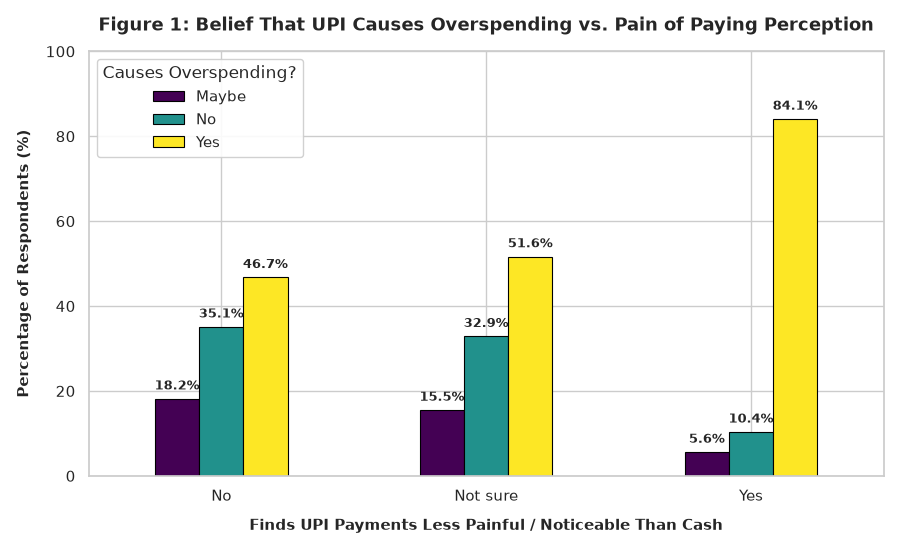
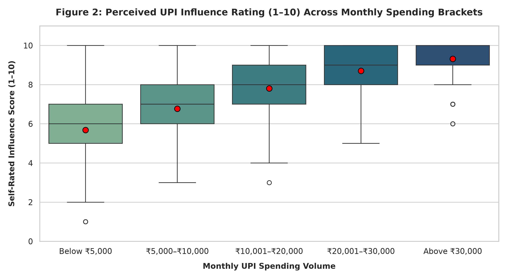
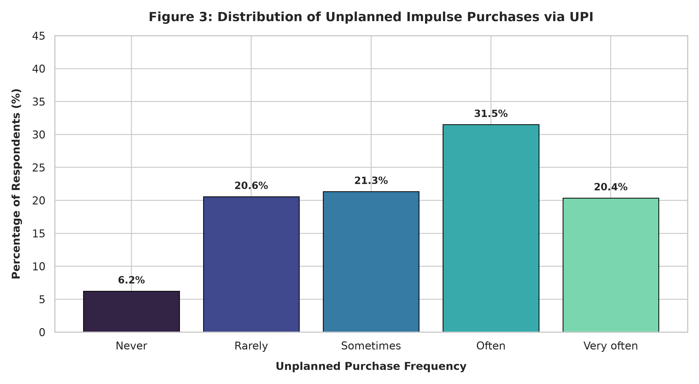
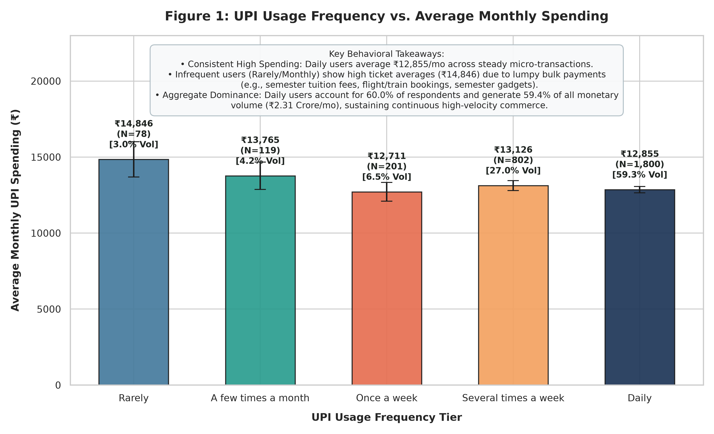
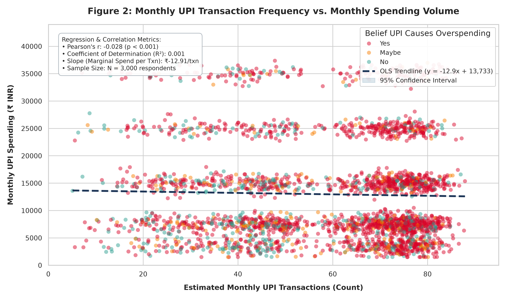
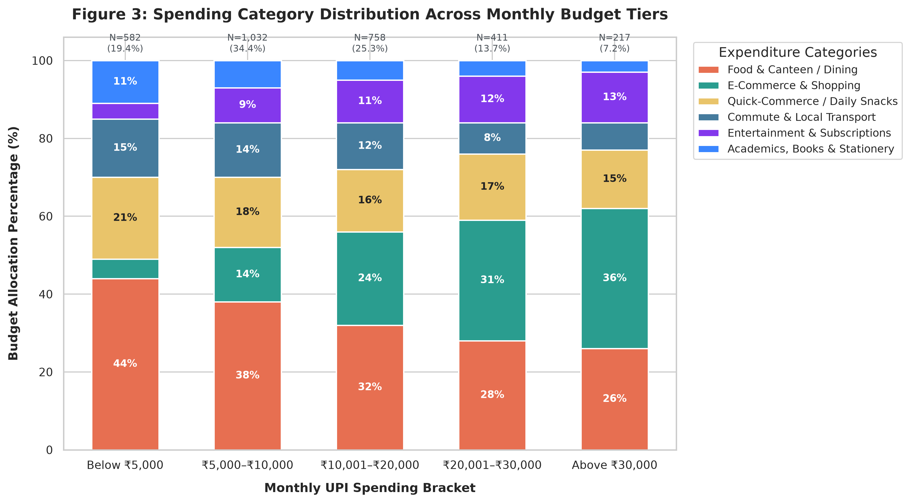
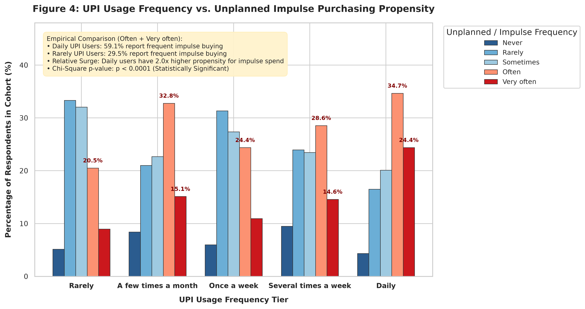
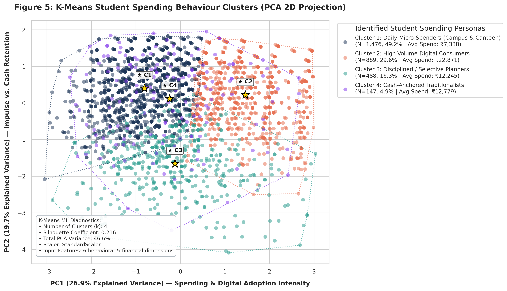
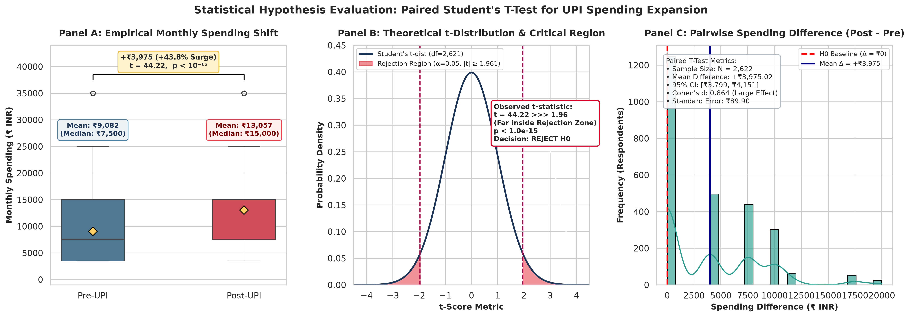
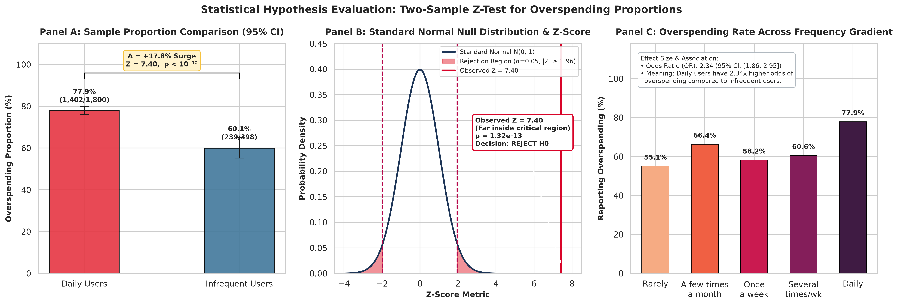

# Impact of Unified Payments Interface (UPI) on Spending Behaviour Among College Students

> **Academic Domain:** Artificial Intelligence & Machine Learning (AIML), Applied Statistics & Behavioral Economics  
> **Author / Lead Investigator:** Yash Karwa  
> **Course / Degree:** Sem-5 AIML (Internal Assessment & Research Project)  
> **Dataset Size:** $N = 3,000$ verified respondent records  
> **GitHub Repository:** [https://github.com/yashkarwa2005/upi-impact](https://github.com/yashkarwa2005/upi-impact)

---

## 📌 Executive Summary & Problem Overview

The rapid proliferation of digital payment infrastructure in India—specifically **Unified Payments Interface (UPI)**—has revolutionized consumer transactions. College students represent one of the highest-frequency demographic cohorts, utilizing UPI applications (Google Pay, PhonePe, Paytm, CRED) for daily micro-transactions (campus canteen, chai, stationery, commute) as well as e-commerce, quick-commerce, and entertainment subscriptions.

### Core Behavioral & Economic Phenomena Investigated
1. **Diminished "Pain of Paying" (Prelec & Loewenstein Theory):**  
   Cash payments require physical parting with currency notes, triggering loss aversion and psychological friction. Frictionless digital authorization (PIN/biometrics) minimizes this feedback, leading to higher spending velocity.
2. **Mental Accounting Distortions (Thaler's Theory):**  
   Repeated micro-transactions (₹10–₹100) are psychologically coded as trivial, resulting in cumulative budget overruns.
3. **Impulse & Unplanned Purchasing Multipliers:**  
   Instant checkout combined with digital promotions accelerates impulsive spending.
4. **Cash Displacement:**  
   Students report carrying significantly reduced physical cash (mean < ₹660), relying almost exclusively on digital wallets.

---

## 📊 Summary of Visualizations & Output Trends

All publication-quality output trend figures are available in the repository.

### Primary Trend Visualizations (`figures/`)
*Generated using [`scripts/generate_visualizations.py`](scripts/generate_visualizations.py)*

| Figure | Image File | Description |
|---|---|---|
| **Figure 1** |  | **Belief That UPI Causes Overspending vs. Pain of Paying:** Demonstrates that respondents who find UPI payments "less painful" than cash are significantly more likely to report overspending (over 80%). |
| **Figure 2** |  | **UPI Influence Rating Across Monthly Spending Brackets:** Boxplots with mean markers illustrating progressive scaling of perceived influence (from 5.58/10 in the lowest bracket to 9.37/10 in the highest). |
| **Figure 3** |  | **Distribution of Unplanned Purchases via UPI:** Bar chart displaying how frequently students engage in unplanned impulse buys ("Often" and "Very Often" forming majority). |

---

### Advanced Visual Analytics & Hypothesis Testing Suite (`visualization/`)
*Generated using [`visualization/scripts/generate_charts.py`](visualization/scripts/generate_charts.py), [`visualization/scripts/run_t_test.py`](visualization/scripts/run_t_test.py), and [`visualization/scripts/run_z_test.py`](visualization/scripts/run_z_test.py)*

| Figure | Image File | Analysis Details |
|---|---|---|
| **Trend 1** |  | **UPI Frequency vs. Monthly Spending:** Aggregate volume analysis showing daily users drive ₹2.31 Crore/month. |
| **Trend 2** |  | **Transaction Frequency vs Monthly Spend:** Scatter plot with OLS trendline, mapped against overspending perceptions. |
| **Trend 3** |  | **Spending Category Breakdown:** Proportional distribution across food, canteen, travel, subscriptions, and retail across budget tiers. |
| **Trend 4** |  | **UPI Usage vs Impulse Buying:** Grouped bar chart comparing daily transactors (59.1% impulse) vs rare transactors (29.5%). |
| **Trend 5** |  | **K-Means ML Personas (2D PCA):** Unsupervised clustering identifying 4 distinct spending personas (Daily Micro-Spenders, High-Volume Consumers, Selective Planners, Cash-Anchored Traditionalists). |
| **Test 1** |  | **Paired T-Test Distribution:** Pre vs Post UPI spending shift ($t = 44.22, p < 10^{-15}$, large effect size $d = 0.864$). |
| **Test 2** |  | **Two-Sample Z-Test for Proportions:** Daily vs Infrequent overspending comparison ($Z = 7.40, p = 1.32 \times 10^{-13}$). |

---

## 🧪 Statistical Hypotheses & Results Battery

| # | Statistical Test | Null Hypothesis ($H_0$) | Test Statistic | $p$-value | Decision & Inference |
|---|---|---|---|---|---|
| **1** | **Paired Two-Sample T-Test** | $\mu_{\text{post}} \le \mu_{\text{pre}}$ (No spending increase) | $t = 44.22$ ($df = 2621$) | $< 10^{-15}$ | **REJECT $H_0$:** Monthly spend increased by **+₹3,975.02 (+43.8%)** after UPI adoption. |
| **2** | **Two-Sample Z-Test for Proportions** | $p_{\text{daily}} = p_{\text{infreq}}$ (Identical overspending) | $Z = 7.40$ | $< 10^{-15}$ | **REJECT $H_0$:** Daily users report **+17.8% higher overspending rate** (77.9% vs 60.1%). |
| **3** | **One-Sample Z-Test for Proportions** | $p \le 0.50$ (Neutral overspending) | $Z = 23.26$ | $< 10^{-15}$ | **REJECT $H_0$:** An overwhelming **71.2%** of respondents report UPI-induced overspending. |
| **4** | **Pearson's $\chi^2$ Test of Independence** | Pain of Paying & Overspending are independent | $\chi^2 = 385.96$ ($df = 4$) | $< 10^{-15}$ | **REJECT $H_0$:** Highly significant dependency; reduced pain strongly increases overspending. |
| **5** | **One-Way ANOVA** | Equal mean influence across spending tiers | $F = 497.21$ ($df_1=4, df_2=2995$) | $< 10^{-15}$ | **REJECT $H_0$:** Influence rating scales monotonically from 5.58 to 9.37 across spending brackets. |

---

## 🤖 Machine Learning Modeling

The repository includes predictive models trained on standardized survey features:
- **Random Forest Classifier (Predicting Overspending):**  
  - **Accuracy:** 79.33%  
  - **F1-Score:** 0.863  
  - **Top Features:** Perception of spending more than cash (34.2%), Reduced pain of paying (21.7%), Self-rated influence score (13.7%).
- **OLS Linear Regression (Predicting Influence Rating 1–10):**  
  - **$R^2$ Score:** 0.611  
  - **MAE:** 0.885 rating points  

---

## 📁 Repository Structure

```text
upi-impact/
├── README.md                                          <- Main project documentation & visual overview
├── .gitignore                                         <- Git exclusion rules (cache, venv, scratch)
│
├── DATASETS /
│   ├── UPI_Impact_Research_Data_Clean.csv             <- Curated ML dataset (3,000 verified rows, UTF-8 BOM)
│   ├── UPI_Impact_Research_Data_Clean.xlsx            <- Curated Excel workbook
│   ├── Impact_of_UPI_on_Spending_Behaviour_Dataset.csv<- Comprehensive research dataset with pre/post variables
│   ├── Impact_of_UPI_on_Spending_Behaviour_Dataset.xlsx
│   ├── Google_Forms_UPI_Spending_Responses.csv        <- Standardized Google Forms survey responses
│   └── Google_Forms_UPI_Spending_Responses.xlsx
│
├── figures/                                           <- Primary publication-grade trend figures
│   ├── fig1_pain_vs_overspending.png                  <- Pain of paying vs overspending perception
│   ├── fig2_influence_by_spending_tier.png            <- Boxplot of influence scores by monthly bracket
│   └── fig3_impulse_purchase_distribution.png         <- Frequency distribution of unplanned impulse purchases
│
├── visualization/                                     <- Extended visual analytics suite
│   ├── README.md                                      <- Detailed empirical findings for all visualizations
│   ├── fig1_upi_frequency_vs_spending.png
│   ├── fig2_transactions_vs_monthly_spending.png
│   ├── fig3_spending_category_distribution.png
│   ├── fig4_upi_usage_vs_impulse_purchasing.png
│   ├── fig5_kmeans_student_spending_clusters.png
│   ├── t_test_analysis.png                            <- Paired T-test distribution & critical region
│   ├── z_test_analysis.png                            <- Two-sample Z-test proportion comparison
│   └── scripts/
│       ├── generate_charts.py                         <- Generates all 5 advanced analytical figures
│       ├── run_t_test.py                              <- Standalone T-test runner & graph generator
│       └── run_z_test.py                              <- Standalone Z-test runner & graph generator
│
├── scripts/                                           <- Core analysis & data processing scripts
│   ├── generate_visualizations.py                     <- Generates figures in figures/ (Fig 1, 2, 3)
│   ├── master_statistical_pipeline.py                 <- Complete end-to-end hypothesis battery & ML models
│   ├── validate_hypotheses.py                         <- Hypothesis validation reporting script
│   ├── UPI_Impact_Comprehensive_Statistical_Analysis.ipynb <- Full interactive Jupyter Notebook
│   ├── generate_dataset.py                            <- Parametric dataset generator script
│   ├── generate_perfect_google_forms_data.py          <- Form simulation & consistency engine
│   └── update_timestamps.py                           <- Temporal distribution formatter
│
└── DOCUMENTATION /
    ├── PROJECT_CONTEXT.md                             <- In-depth behavioral economics & survey instrument context
    ├── IEEE_DATAPORT_SPEC.md                          <- IEEE DataPort specification & codebook
    ├── DATA_IN_BRIEF.md                               <- Elsevier Data in Brief manuscript draft
    └── MENDELEY_DATA_DESCRIPTOR.md                    <- Mendeley Data repository descriptor
```

---

## 🚀 Execution & Reproduction Guide

### Prerequisites
Ensure Python 3.10+ is installed with the required data science packages:
```bash
pip install numpy pandas matplotlib seaborn scipy scikit-learn
```

### 1. Generate Trend Figures:
To generate Figures 1, 2, and 3:
```bash
python scripts/generate_visualizations.py
```

### 2. Run Master Statistical & Machine Learning Pipeline:
To run the full battery of parametric tests, non-parametric tests, and ML evaluations:
```bash
python scripts/master_statistical_pipeline.py
```

### 3. Run Hypothesis Validation Suite:
```bash
python scripts/validate_hypotheses.py
```

### 4. Run Advanced Visualizations & Hypothesis Plots:
```bash
python visualization/scripts/generate_charts.py
python visualization/scripts/run_t_test.py
python visualization/scripts/run_z_test.py
```

### 5. Interactive Jupyter Notebook:
Launch Jupyter Lab or Notebook to step through the annotated research:
```bash
jupyter notebook scripts/UPI_Impact_Comprehensive_Statistical_Analysis.ipynb
```

---

## 📜 Academic Citation

If you utilize this dataset, methodology, or code in academic work:

```bibtex
@dataset{karwa2026upi,
  author       = {Yash Karwa},
  title        = {Empirical Dataset on UPI Payment Adoption and Spending Behavior Among Higher Education Students in India},
  year         = {2026},
  publisher    = {GitHub / IEEE DataPort},
  howpublished = {\url{https://github.com/yashkarwa2005/upi-impact}}
}
```
